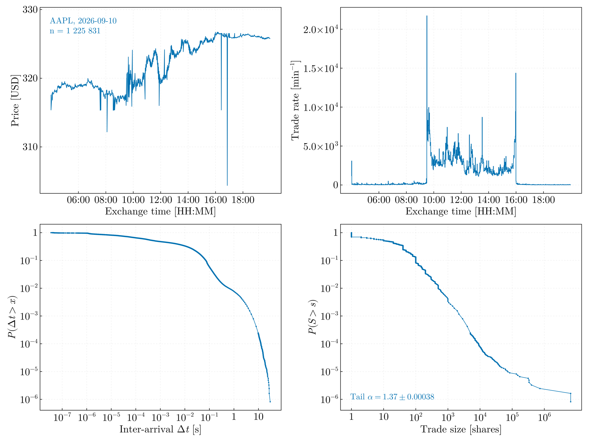
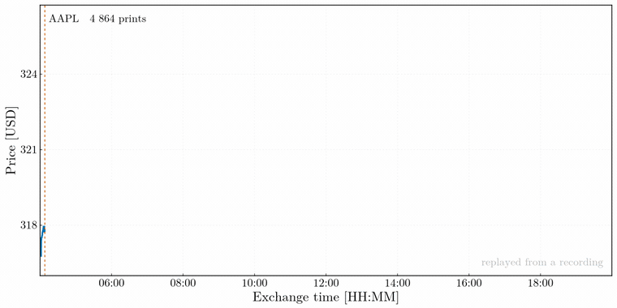

# MarketTickStreamer.jl

[](https://PaulGoG.github.io/MarketTickStreamer.jl/stable/)
[](https://github.com/PaulGoG/MarketTickStreamer.jl/actions/workflows/CI.yml)
[](https://codecov.io/gh/PaulGoG/MarketTickStreamer.jl)
[](https://github.com/JuliaTesting/Aqua.jl)
[](LICENSE)

Provider-agnostic tick-by-tick market data acquisition in pure Julia, built
for scientific time series research. It streams trades live over WebSocket,
backfills history from REST pages or the venue's daily dumps, imports vendor
day files (Nasdaq TotalView-ITCH 5.0, IEX HIST), persists raw prints
append-only and compacts them to analysis-ready files. A recorded session
replays at its original pace, and `follow_source` follows a running session
from another process, so real-time analysis methods can be developed offline
and reproducibly.

**[Manual](https://PaulGoG.github.io/MarketTickStreamer.jl/stable/)** ·
[Architecture](https://PaulGoG.github.io/MarketTickStreamer.jl/stable/architecture/) ·
[Configuration](https://PaulGoG.github.io/MarketTickStreamer.jl/stable/usage/) ·
[Analysis interfaces](https://PaulGoG.github.io/MarketTickStreamer.jl/stable/replay/) ·
[Files & provenance](https://PaulGoG.github.io/MarketTickStreamer.jl/stable/files/) ·
[Unattended operation](https://PaulGoG.github.io/MarketTickStreamer.jl/stable/deployment/) ·
[API](https://PaulGoG.github.io/MarketTickStreamer.jl/stable/api/) ·
[Changelog](CHANGELOG.md)

## File structure

```
.
├── Project.toml        # package environment and [compat]
├── activate.jl         # silent activation; one per environment (scripts/, test/, docs/, bench/, examples/)
├── config/config.toml  # every tunable
├── src/                # the package: errors, schema, config, sinks, quality, resample, corpus, replay, follow, monitor, rest, live, providers/, formats/, pipeline, import, diagnostics, figures
├── ext/                # package extensions: figures (CairoMakie), terminal plots (UnicodePlots)
├── scripts/            # entry points: stream, backfill, import, compact, inventory, replay, monitor, visualize (own environment)
├── examples/           # worked consumers of the Channel{Trade} interface (own environment)
├── test/               # offline suite: unit, mock-server end-to-end, static QA (own environment)
├── bench/              # BenchmarkTools suite over the acquisition hot paths (own environment)
├── docs/               # Documenter manual (own environment)
└── data/, logs/, plots/  # run outputs, gitignored
```

The full tree is at the [end of this file](#full-file-tree).

## Setup

Requires Julia ≥ 1.12. No `Manifest.toml` is tracked: each environment resolves
from its `[compat]` bounds on first activation, and every capture session
stores a copy of the manifest it ran with next to its provenance sidecar. From
a clone:

```bash
julia -i activate.jl        # activates and instantiates, then leaves a REPL
```

The package has no plotting dependency. The diagnostic figures are a package
extension that loads with CairoMakie, and the monitor's terminal plots one
that loads with UnicodePlots:

```julia
using MarketTickStreamer, CairoMakie    # session_figure, overview_figure, save_*_figures
using MarketTickStreamer, UnicodePlots  # monitor_raw draws its rate history and bar chart
```

Without them everything else works, `monitor_raw` prints a text dashboard, and
a call to a figure function says which package to load. The scripts have their
own environment with both installed.

Relative paths in a configuration (`storage.data_dir`, `logging.log_dir`,
`credentials.env_file`) are relative to the configuration file, so the shipped
`config/config.toml` writes to `data/` and `logs/` of the clone. A project that
installs the package (`Pkg.add(url = ...)`) copies that file and passes the
copy's path to `load_config`; the installed file,
`MarketTickStreamer.DEFAULT_CONFIG`, is a read-only template.

For credentials, `cp .env.example .env` and fill in `ALPACA_API_KEY_ID` and
`ALPACA_SECRET_KEY` (free keys at https://alpaca.markets). Paper-account keys
work with `[alpaca] trading_base` pointed at the paper endpoint, as in the
shipped config. Feeds on the free tier: `iex` (real-time, single venue) and
`delayed_sip` (consolidated tape, 15 min delayed; the default here, and
complete against the historical tape in validation); `sip` (real-time
consolidated) requires a paid subscription.

## Entry points

All behavior is driven by `config/config.toml`; every script accepts an
alternative config path. Each script activates and instantiates its
environment as its first statement, so a fresh clone needs no manual
environment step.

```bash
# live capture (Ctrl-C drains buffers and exits cleanly)
julia --threads=auto scripts/stream.jl

# historical backfill over [backfill.start_date, backfill.end_date]
#   (backfill.source = "bulk": Binance's daily dump files instead of REST pages)
julia scripts/backfill.jl

# import one vendor day file (Nasdaq ITCH 5.0 or IEX HIST) into processed/
julia scripts/import.jl itch50 data/bulk/itch50/12302019.NASDAQ_ITCH50.gz --symbols=AAPL,MSFT

# compact raw session files into per-symbol per-day CSV/Arrow
julia scripts/compact.jl data/raw/<session>_part001.jsonl

# inventory of the processed tree: days, span, prints and bytes per symbol
julia scripts/inventory.jl

# replay a recorded session as a live-like paced stream
julia scripts/replay.jl data/raw/<session>_part001.jsonl

# QA report (duplicates, gaps, ordering, latency) + diagnostic figures → plots/
julia scripts/visualize.jl data/raw/<session>_part001.jsonl

# live dashboard for a running capture/backfill (separate terminal, read-only;
# tick rate, tape head/lag, per-symbol counts; --full for session totals)
julia scripts/monitor.jl

# test suite (offline: unit, mock-server end-to-end, static QA — Aqua, JET, ExplicitImports, AllocCheck)
julia -e 'include("activate.jl"); using Pkg; Pkg.test()'

# worked consumer examples (own environment; adds OnlineStats.jl)
#   waiting times, lossless tap, every gap retained
julia examples/waiting_times.jl data/raw/<session>_part001.jsonl
#   live diagnostics, lossy tap, constant-memory sketches
julia examples/live_diagnostics.jl data/raw/<session>_part001.jsonl
#   follow a running session from another process
julia examples/follow_session.jl

# benchmark suite (own environment; slow first run while it instantiates)
julia bench/benchmarks.jl

# documentation site (own environment; output in docs/build/)
julia docs/make.jl

# regenerate the figures the README shows, from one of your own captures
julia docs/make_readme_assets.jl data/raw/<session>_part001.jsonl
```

For interactive work on individual test sets, `julia -i test/activate.jl`
opens the test environment.

From the REPL, the same entry points are `run_stream(cfg)`,
`run_backfill(cfg)`, `compact_raw(files, out)`,
`read_processed(cfg, "AAPL"; from, to, window = :regular)`,
`replay_source(files)` and `follow_source(cfg.raw_dir)`. The last two return
a `Channel{Trade}` indistinguishable from the live source, so a real-time
consumer can be developed offline (see `docs/src/replay.md`).

## Status

Feature complete and in maintenance mode from 2.0.0 (see
[Maintenance](#maintenance)). Every component below works and is covered by
the offline suite: unit tests and end-to-end runs against in-process mocks.
The second column records verification beyond that.

| Component | Verification beyond the suite |
|---|---|
| Live trade streaming (Alpaca IEX/SIP) |  |
| Binance spot adapter (public, 24/7, UTC calendar, `trade` + `aggTrade`, microsecond timestamps) | validated against the live API |
| Provider-agnostic config, calendar and trading-day dispatch |  |
| Reconnection, stale-connection watchdog, orderly shutdown |  |
| Market-hours guards (wait-for-open, auto-stop at close, incl. half-day early close) |  |
| Unattended operation (systemd user service + timer; SIGINT stop, wait-for-open, stop-at-close) | units verified with systemd-analyze on systemd 259 |
| Delayed-feed handling (market-hours guards shifted by feed delay; tape tail captured) |  |
| Per-session provenance sidecars (`.meta.toml`) with a manifest snapshot |  |
| Resource guards (disk space, RAM ceiling with auto-GC, channel lag, REST backoff) |  |
| Crash-only session lifecycle (running/completed/interrupted/failed sidecars + startup reconciliation to aborted) |  |
| Page-streaming, per-day resumable backfill |  |
| Bulk backfill from the venue's daily files (Binance `aggTrades` and `trades` dumps: checksum-verified, kept as the vendor record, same raw/compaction/resume path; `keep_raw = false` drops the NDJSON copy) |  |
| Vendor day-file import (Nasdaq ITCH 5.0 executions priced off the book, crosses, odd lots, breaks; IEX HIST pcap/pcapng, IEX-TP sessions, trade reports and breaks) through the raw/compaction/sidecar path | validated on full days of both: ITCH prints equal the SIP's Nasdaq prints apart from the official opening and closing cross reports (and a rare zero-size print), IEX prints equal the SIP's IEX prints in order |
| Vendor file download (ITCH and IEX day files, Binance dumps): bounded Range requests resumed from a `.partial` prefix, announced size or CRC-32C checked, optional rate cap, several connections per file, progress logged | used on full vendor days of up to 18 GB |
| Spill compaction (bounded memory for arbitrarily large raw inputs) |  |
| Single-instance lock per data tree |  |
| Capture-coverage cross-check against the historical tape (`coverage_report`) | Alpaca only; a Binance day is verified by its vendor checksum and trade-id continuity |
| Lossy-tap option in `tee` fan-out (persistence always wins) |  |
| Batched raw NDJSON persistence + rolling |  |
| Historical backfill (paginated REST) |  |
| Compaction to CSV/Arrow with duplicate removal (Arrow dictionary-encoded, optional zstd/lz4) |  |
| Session QA report (duplicates/gaps/ordering/latency) |  |
| Diagnostic figures (price, activity, Δt & size CCDFs; HH:MM axes, log ticks at powers of ten, tail-exponent annotations) | figures inspected |
| Multi-day overview figures (trading-time price, activity heatmap, intra-session waiting-time CCDF) | figures inspected |
| Live monitoring dashboard (attach-mode; text, plots with UnicodePlots loaded) |  |
| Paced replay (absolute schedule; receive or exchange clock; optional cap on gaps; a session from raw files, a corpus streamed day by day from the processed tree) |  |
| Corpus query path (`corpus_inventory`, `eachday`, `read_processed`: date range, exchange-local time window, price-forming population, memory guard) |  |
| Quotes (`q`) / bars (`b`) normalization | parsed to `Quote`/`Bar` with `on_quote`/`on_bar`; not persisted (trades only, by decision) |
| Sale-condition eligibility (`price_forming`, per-tape lists from the CTA and UTP sale-condition matrices, `n_price_forming`) | capture is never filtered; the choice is made at analysis time |
| Resampling onto activity clocks (`tick_bars`, `volume_bars`, `dollar_bars`) and onto matching events (`event_bars`: the prints of one instant as one bar) |  |
| File-following source (`follow_source`: a consumer in another process follows a running session's raw files; ends with the sidecar) |  |
| Real-time analysis consumers | interface contract documented; three worked examples under `examples/`, all executed by the suite |
| Credential validation (paper account): clock REST, historical SIP REST, WS auth on `iex` and `delayed_sip` | verified 2026-08-01 |
| Live capture validation against real Alpaca feed | verified 2026-08-06: 3 h `delayed_sip` session, 24 symbols, 3.17 M prints; QA clean (0 duplicates/out-of-order/gaps); coverage matched the historical tape exactly for 22 of 24 symbols and to better than 99.9996 % for the other two |

## Public surface and versioning

From 1.0.0 the following are public and versioned under semantic versioning:

- the exported Julia API and its documented keyword arguments, and the names
  declared `public` without being exported, reached qualified
  (`MarketTickStreamer.RawSink`);
- the file contract — raw parts, sidecars, processed day files, vendor files
  and the lock — specified on the
  [files page](https://PaulGoG.github.io/MarketTickStreamer.jl/stable/files/);
- the configuration schema of `config/config.toml`;
- the arguments and products of the entry-point scripts.

A change that alters what a consumer reads from the data tree, rejects a
configuration previously accepted, changes a script's arguments or products,
or removes or changes an exported name or its documented behavior is
breaking and waits for a major release.

Internals (`_`-prefixed or undocumented names) may change in a minor release.

2.0.0 changed the Julia API in four places (modes as `Symbol`s, one return
shape for the trade readers, package exception types, self-registering
providers) and left the file contract and the scripts as they were; the
configuration schema changed only in rejecting an unknown key in a provider
table, as it rejects one in any other. The
[migration page](https://PaulGoG.github.io/MarketTickStreamer.jl/stable/migration/)
lists every change with its replacement.

## Maintenance

The package is feature complete: it captures, backfills, imports, stores,
replays and follows trade tapes for the venues and vendor formats listed
under [Status](#status), and its analysis interface is the `Channel{Trade}`
and the file contract. From 2.0.0 it is maintained rather than extended.
Maintenance covers

- defects, fixed in patch releases;
- changes on the venues' side (API versions, endpoints, wire and file
  formats), followed in patch or minor releases;
- dependency `[compat]` updates (Dependabot opens them weekly) and support
  for new Julia releases, with the floor at 1.12;

and only the latest major release receives them. New features are not
planned. An adapter for another venue belongs in a package of its own: the
provider interface registers it without a change here (see "Adding a
provider" on the
[providers page](https://PaulGoG.github.io/MarketTickStreamer.jl/stable/api_providers/)).
Analysis methods belong downstream, consuming the channel or the files.

## Output



<sub>One trading day of one symbol, rendered by `scripts/visualize.jl`: price
path and trade rate over exchange-local time, and the survival functions of
inter-arrival time and trade size. The inter-arrival distribution spans seven
orders of magnitude, from sub-microsecond bursts to gaps of tens of
seconds.</sub>



<sub>A recording replayed through `replay_source`, which returns the same
`Channel{Trade}` type a live session yields. A consumer written against one
runs unchanged against the other, so a real-time method can be validated
offline before it runs live.</sub>

## Data layout

The full contract, for consumers in any language, is on the
[files page](https://PaulGoG.github.io/MarketTickStreamer.jl/stable/files/).

- `data/raw/` — append-only NDJSON, one normalized `Trade` per line,
  session-stamped filenames, size-rolled parts, never overwritten. Source of
  truth; line-by-line recoverable after a crash.
- `data/raw/<session_id>.meta.toml` — provenance sidecar per session:
  lifecycle status (`running`, then `completed`, `interrupted` or `failed`;
  `aborted` when reconciled after a crash), session summary (prints
  received; for a backfill or import also the prints stored after duplicate
  removal), git commit, Julia/package versions, hardware fingerprint (CPU,
  memory, thread counts, `versioninfo`), full effective configuration
  snapshot.
- `data/bulk/binance/SYMBOL/` — the venue's daily dump files and their checksums, as downloaded by a bulk backfill; the vendor's record of each day.
- `data/bulk/itch50/`, `data/bulk/iex/` — Nasdaq ITCH 5.0 and IEX HIST day files as downloaded (`fetch_itch50`, `fetch_iex_hist`), verified against the announced size or CRC-32C.
- `data/processed/SYMBOL/YYYY-MM-DD.csv|.arrow` — compacted, time-sorted
  per-day files for the analysis pipeline. Existing files are never
  destroyed (the new file takes the canonical name; the displaced one is
  kept as a `_#N` backup).
- Timestamps are Int64 nanoseconds since the UNIX epoch (UTC) everywhere;
  `time_ns` is the exchange timestamp, `recv_ns` local receive time
  (`0` marks backfilled records).

## Testing

The suite runs fully offline: unit tests plus end-to-end runs (stream →
reconnect → fatal stop → raw files → compaction → replay, backfill, bulk
backfill) against in-process mocks of the Alpaca REST + WebSocket APIs and
of the Binance REST, WebSocket and bulk-file endpoints — no credentials or
network needed. The vendor readers and the import run on synthetic ITCH 5.0
and IEX HIST files, the three worked examples are executed, and static QA
runs with the suite: Aqua, JET, ExplicitImports and AllocCheck.

## How to cite

Citation metadata is in [`CITATION.cff`](CITATION.cff). BibTeX:

```bibtex
@software{MarketTickStreamer_jl,
  author  = {Gogîță, Paul-Adrian},
  title   = {MarketTickStreamer.jl: provider-agnostic tick-by-tick market data acquisition and paced replay in Julia},
  version = {2.0.1},
  year    = {2026},
  url     = {https://github.com/PaulGoG/MarketTickStreamer.jl}
}
```

## Full file tree

<details>
<summary>Full file tree</summary>

```
.
├── Project.toml            # package environment and [compat]
├── .JuliaFormatter.toml    # committed formatting configuration (JuliaFormatter.jl)
├── .env.example            # credential template → copy to .env (gitignored)
├── activate.jl             # silent activation of the package environment
├── config/
│   └── config.toml         # every tunable
├── src/
│   ├── MarketTickStreamer.jl     # module root: imports, exports, includes
│   ├── errors.jl           # exception types: MarketTickStreamerError and its subtypes
│   ├── schema.jl           # Trade struct; Int64-ns timestamps; RFC 3339 parsing; reader pages
│   ├── config.jl           # TOML loading/validation; .env credential loading
│   ├── sinks.jl            # raw NDJSON sink (append-only, rolling); compaction
│   ├── quality.jl          # dedup, session QA report, disk-space probe,
│   │                       #   sale-condition (price-forming) predicates
│   ├── resample.jl         # tick / volume / dollar bars — activity clocks; event bars
│   ├── monitor.jl          # attach-mode terminal dashboard (tails raw files)
│   ├── corpus.jl           # corpus query path: inventory, day iteration, guarded reads
│   ├── replay.jl           # recorded-session replay source (paced or max-rate)
│   ├── follow.jl           # file-following source: tail a session's raw parts, end with its sidecar
│   ├── live.jl             # provider-agnostic live source: reconnect, watchdog,
│   │                       #   market-close guard
│   ├── rest.jl             # REST policy and retry schedule; resumable vendor downloads
│   ├── pipeline.jl         # session orchestration: run_stream / run_backfill; tee
│   ├── import.jl           # vendor day files → processed/: run_import
│   ├── diagnostics.jl      # plotting-free numerics of the figures: CCDF, decimation, Hill
│   ├── figures.jl          # figure interface: documented stubs the extension implements
│   ├── providers/
│   │   ├── alpaca.jl       # Alpaca adapter: US equities, NY calendar, credentialed
│   │   └── binance.jl      # Binance adapter: crypto spot, UTC calendar, public
│   └── formats/
│       ├── itch50.jl       # Nasdaq TotalView-ITCH 5.0 day files → Trade
│       └── iex_hist.jl     # IEX HIST pcap/pcapng captures → Trade
├── ext/
│   ├── MarketTickStreamerMakieExt.jl         # session and overview figures (loads with CairoMakie)
│   └── MarketTickStreamerUnicodePlotsExt.jl  # monitor rate history and bar chart (loads with UnicodePlots)
├── scripts/
│   ├── Project.toml        # scripts environment: the package by path, CairoMakie, UnicodePlots
│   ├── activate.jl         # silent activation; included by every script
│   ├── cli.jl              # argument parsing shared by the scripts
│   ├── stream.jl           # live capture session
│   ├── backfill.jl         # historical trade download
│   ├── import.jl           # vendor day file import
│   ├── compact.jl          # raw NDJSON → per-symbol per-day CSV/Arrow
│   ├── inventory.jl        # inventory of the processed tree
│   ├── replay.jl           # replay a recorded session to the terminal
│   ├── monitor.jl          # live dashboard for a running session (read-only)
│   └── visualize.jl        # QA report + per-symbol per-day diagnostic figures
├── test/
│   ├── Project.toml        # test environment; consumes the package by path
│   ├── activate.jl         # silent activation of the test environment
│   ├── runtests.jl         # unit + end-to-end tests
│   ├── mock_alpaca.jl      # in-process mock of Alpaca REST + WebSocket APIs
│   └── mock_binance.jl     # in-process mock of Binance REST + WebSocket APIs
├── examples/
│   ├── Project.toml        # examples environment (package consumed by path)
│   ├── activate.jl         # silent environment activation
│   ├── waiting_times.jl    # worked consumer: replay → tee → waiting times
│   ├── live_diagnostics.jl # worked consumer: bounded-memory live statistics
│   └── follow_session.jl   # worked consumer: follow a running session from another process
├── bench/
│   ├── Project.toml        # benchmark environment (package consumed by path)
│   ├── activate.jl         # silent environment activation
│   └── benchmarks.jl       # BenchmarkTools suite over the hot paths
├── docs/
│   ├── Project.toml        # documentation environment (package consumed by path)
│   ├── activate.jl         # silent environment activation
│   ├── make.jl             # Documenter build → docs/build/
│   ├── make_readme_assets.jl  # regenerate the figures shown above, from a capture
│   └── src/                # manual: index, architecture, usage, replay, files, deployment, migration, API
│       └── assets/         # the rendered figures the README and manual show
├── .github/
│   ├── dependabot.yml      # weekly dependency updates: julia, github-actions
│   └── workflows/
│       └── CI.yml          # tests (stable + compat floor + prerelease),
│                           #   formatting check, docs build & deploy
├── LICENSE                 # MIT
├── CHANGELOG.md            # release history (Keep a Changelog)
├── CITATION.cff            # citation metadata
├── CONTRIBUTING.md         # environment, tests, formatting, commits, versioning
├── codecov.yml             # coverage reporting: informational status, no PR comments
├── data/                   # (gitignored, created on demand) raw/, processed/, bulk/
├── plots/                  # (gitignored) rendered diagnostic figures
└── logs/                   # (gitignored) per-session log files
```

</details>

## Contributing

Environment, tests, formatting and commit conventions are in
[`CONTRIBUTING.md`](CONTRIBUTING.md).

## License

MIT — see `LICENSE`.
