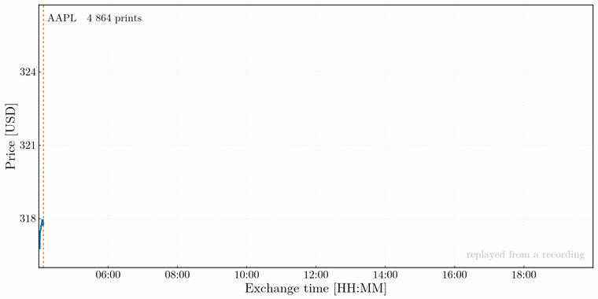

# Replay and analysis interfaces

Analysis pipelines are external to this package. They get a stream with a
written contract, set out below, and a way to develop against it while the
market is closed.

The pipelines this package was built to feed (exact waiting-time distributions
of scalar series, long-memory estimation, criticality in tick arrival) live
in packages of their own, and nothing here depends on them. Three worked
consumers ship under `examples/`, and the test suite executes all three, so
an interface change that breaks one fails the suite.



## The three sources

[`live_source`](@ref), [`replay_source`](@ref) and [`follow_source`](@ref)
all hand back a `Channel{Trade}`. A consumer written against one works
unchanged against the others, so a real-time method can be developed and
validated on recorded flux before it runs live.

```julia
using MarketTickStreamer

# Recorded session, re-emitted at the original inter-arrival times.
ch = replay_source("data/raw/session_part001.jsonl")

for trade in ch                      # terminates when the recording ends
    # ... the analysis method under test
end
```

`pace = :max` drops the pacing and emits as fast as the consumer takes
them, which is the mode for throughput work; `speed` compresses recorded
time, so `speed = 60.0` replays an hour of tape in a minute.

A session is replayed from its raw files, which are read whole. A corpus is
replayed from the processed tree, and streamed: the files of one trading day,
one per symbol, are loaded, merged on the clock and emitted before the next
day is opened, so a symbol-year replays in the memory of its busiest day.

```julia
files = processed_files("data/processed", "AAPL"; from = Date(2026, 5, 1))
for trade in replay_source(files; pace = :max)
    # ... an estimator run over months of tape
end
```

Six AAPL days, 5.6 million prints, go through at about a million prints per
second with the resident set flat at 1.2 GiB from the first day to the last.
The bound is the busiest date summed over the requested symbols, at about
100 bytes per print in memory: the busiest AAPL day of a one-year capture,
2.2 million prints, holds 215 MiB, so two dozen names of that liquidity
need about 5 GiB. The replay clock is settled on the first day and held
for the rest: a later day that lacks the receive clock the first one had
ends the replay with an error rather than switch clocks halfway.

Recorded pace keeps one schedule across the days, closures included, so
replaying a week at `speed = 1` takes a week. `max_gap_s` caps every gap on
the replay clock, in recorded seconds, and leaves the timing within a
session as it was:

```julia
# A month of sessions at ten times real time, each closure replayed as 1 s.
replay_source(files; speed = 10.0, max_gap_s = 10.0)
```

The cap needs no notion of a market closure, so it serves a venue that
trades around the clock in the same way. If a later day cannot be read, the
channel closes with that error and the consumer's loop rethrows it, after
every earlier print has been delivered.

### Following a running session

The third source reads a session while it is being written, from another
process:

```julia
# Another process: follow the capture as it is flushed; ends with the session.
for trade in follow_source(cfg.raw_dir)
    # ...
end
```

[`follow_source`](@ref) tails the session's raw parts and delivers their
prints in file order, which is the arrival order of the capture, as the sink
flushes them. A torn final line is carried until its newline arrives, and
when the sink rolls to a new part the follower moves on to it. The channel
closes once the sidecar's status leaves `running`, after every line flushed
until then has been delivered, so a finished session is read whole and the
loop ends at its last print. `idle_timeout_s` (default `Inf`, no bound) sets
how long the files may stay unchanged while the sidecar still says
`running`; past it the channel closes with an error, so a follower of a
process that died unreconciled does not wait forever. The capture neither
knows of its follower nor waits for it; the two share only the files. The
[files page](files.md) sets this streaming consumer beside the stationary
one that reads the processed tree.

## The `Trade` record

| Field | Type | Meaning |
| --- | --- | --- |
| `symbol` | `String` | Ticker as the venue reports it. |
| `time_ns` | `Int64` | Exchange timestamp, nanoseconds since the UNIX epoch (UTC). |
| `recv_ns` | `Int64` | Local receipt timestamp, same units; `0` for a print that never crossed the wire (backfill, import). |
| `price` | `Float64` | Trade price. |
| `size` | `Float64` | Trade size. Float rather than integer because fractional-share prints exist. |
| `exchange` | `String` | Reporting venue code. |
| `conditions` | `Vector{String}` | Sale-condition codes as reported; not filtered. |
| `tape` | `String` | Tape identifier: `A`, `B` or `C` on US equities, `SPOT` on Binance; may be empty. |
| `id` | `Int64` | Venue trade identifier; `0` when the venue gives none. |

With both `time_ns` and `recv_ns` recorded, feed latency can be measured
after the fact.

`Trade` has value semantics (`==`, `isequal` and `hash` compare fields, not
the identity of the `conditions` vector), so round-tripping through the raw
layer produces objects that compare equal.

## Guarantees

**Ordering.** Replay emits in ascending order of its clock, sorted on load:
`recv_ns` when every record carries one, `time_ns` otherwise (`clock = :auto`;
either can be forced). Backfilled records have `recv_ns = 0`, so a backfilled
recording replays on exchange time. A corpus replayed from processed day
files is sorted one exchange date at a time: on the exchange clock the order
holds across dates, while on the receive clock the first prints of a date can
precede the last of the date before by the feed's latency. The live source
emits in arrival order, which is *not* the same as ascending `time_ns`: a
consolidated tape interleaves venues, and late prints are normal. Any method
that needs monotone exchange time must sort or reject explicitly;
[`session_report`](@ref) quantifies how often it happens in a given capture.

**Pacing.** Each emission is scheduled against the absolute time elapsed since
the first record, not slept gap by gap. `sleep` overshoots by about a
millisecond, so per-gap sleeping stretches a session whose gaps are of that
order (by 65 % on gaps of 2.5 ms), whereas on an absolute schedule the error
stays within one overshoot however long the replay runs. Gaps below a
millisecond are emitted back to back, in order.

**Completion.** Every source closes the channel when the stream ends: the
recording exhausted, the session deadline reached, the market closed, a
fatal protocol error, the followed session finished. A `for t in ch` loop
therefore terminates on its own, and a consumer needs no separate shutdown
signal.

**Backpressure.** The channel is bounded (`limits.channel_capacity`). A slow
consumer blocks the producer, and on a live session that propagates into TCP
backpressure rather than into unbounded memory growth. Blocking is the
default because dropping ticks silently would bias the arrival statistics a
consumer measures.

**Determinism.** Replaying the same files with `pace = :max` yields the
identical sequence every time. With `pace = :recorded` the *sequence* is
identical but the *timing* is approximate: gaps under a millisecond are not
resolvable by `sleep`, so they are emitted back to back.

## Fanning out to several consumers

[`tee`](@ref) splits one stream into independent channels, with a per-output
overflow policy:

```julia
session = live_source(provider, cfg)
persist, analyze = tee(session.channel, 2; lossy = [false, true])
```

A non-lossy output blocks the fan-out when full; persistence belongs on one.
A lossy output drops incoming ticks instead of stalling the capture, counts
the drops, and reports them through `on_drop`. An analysis tap that
occasionally cannot keep up belongs on a lossy output; one whose results
depend on seeing every print does not, and should instead run offline against
the raw files, where nothing is ever dropped.

## Snapshots on the exchange clock

A consumer that accumulates state over the stream (an OnlineStats set, a
waiting-time histogram) publishes it under one convention, implemented by
[`snapshots`](@ref): at every multiple of a period on the exchange clock,
and once more when the channel closes. Each snapshot is stamped with its
boundary and with the number of prints folded so far, a window without
prints still yields one, and the final snapshot carries the last print's
timestamp.

```julia
rows = Tuple{Int64,Int,Float64}[]
n = snapshots(analyze, 60 * 10^9; on_snapshot = (at, k, _) -> push!(rows, (at, k, vwap(acc)))) do t
    observe!(acc, t)
end
```

Wall time never enters: the snapshots are a function of the sequence
alone, so a replay at any pace reproduces those of the live session, and
two consumers on one [`tee`](@ref) produce aligned rows. The monitor's
refresh interval is a display cadence and is not a snapshot clock.

## A worked consumer

`examples/waiting_times.jl` replays a recorded session, splits it with
[`tee`](@ref) into two consumers, both on lossless outputs, accumulates
inter-arrival times in a single pass, and stops when the channel closes,
with no shutdown protocol of its own.

```bash
julia examples/waiting_times.jl data/raw/<session>_part001.jsonl
```

It reports both populations side by side, which shows what the choice costs
on a given capture. One AAPL session, 1 225 831 prints:

```
every execution          n=  1225830  mean=  0.0470 s  median=  0.0007 s  p99=  0.6231 s  max=   30.080 s
price-forming only       n=   408793  mean=  0.1409 s  median=  0.0005 s  p99=  1.4756 s  max=  116.269 s
```

A median of 0.7 ms against a mean of 47 ms marks a strongly right-skewed
distribution. Restricting the sample to price-forming prints, mostly by
dropping odd lots, raises the mean roughly threefold while the median stays
below a millisecond: it thins the dense clusters and stretches the tail
without rescaling the whole distribution.

Both `tee` outputs in the example are lossless. At maximum replay rate a
lossy tap lost 85 000 of those prints, and not uniformly: the losses fall
in the bursts, which hold the short waiting times. Backpressure costs nothing
offline, since a blocked output only slows the replay.

A third, `examples/follow_session.jl`, follows a running session from another
process with [`follow_source`](@ref) and applies [`snapshots`](@ref) to it:
one row per minute of exchange time and a final row when the session ends.

## Which prints count as trades

`conditions` is reported and never acted on at capture. Whether a print
belongs in a sample depends on the question, and the two questions this
package serves want opposite answers:

- A price path (returns, volatility, Hurst or DFA estimation) needs
  price-forming prints only. Odd lots, contingent and derivatively priced
  trades carry prices the tape plans keep out of the consolidated last sale;
  the average-price and derivatively priced ones can lie far from the market,
  and differencing them adds spurious variance to the returns.
- An arrival process (waiting-time distributions, tick intensity,
  criticality) needs every execution. An odd lot is an actual execution, and
  dropping it distorts the law under study.

So [`price_forming`](@ref) and [`filter_price_forming`](@ref) operate on
loaded prints, and [`session_report`](@ref) reports `n_trades` beside
`n_price_forming` so the size of the distinction is measured per capture
rather than assumed. The gap is dominated by odd lots and grows with share
price, so it varies strongly across a basket.

The default population, [`NON_PRICE_CONDITIONS`](@ref), follows the tape
plans' own sale-condition matrices: a code is excluded when the plan does not
let it update the consolidated last sale, or lets it only when it is the sole
qualifying trade of the day. That takes out odd lots, average-price prints
(`B` on tapes A and B, `W` on tape C), prices fixed earlier or elsewhere
(`P`, `4`), late reports (`Z`, `U`), contingent trades and non-regular
settlement. Extended-hours prints (`T`) stay in, because at tick resolution
they are the price path of their session. The corrected consolidated close
(`9`) is excluded although the plans let it update the last sale, since at
tick resolution it is a correction message. Average-price and derivatively
priced prints are few, about 3 % of what otherwise passes on a liquid Nasdaq
name, but they are the ones that can lie several percent from the market: on
one AAPL session they moved the day's price-forming minimum from 316.00 to
304.35. The lists are configuration (`[quality.non_price_conditions]`), so
the population a session was reported under is recorded in its sidecar.

State which of the two populations a result used. After the fact, a price
series does not reveal it.

## Activity clocks

Market activity is not uniform in time, so sampling a price path every minute
draws unevenly from the process that generates it: densely at the open,
sparsely at lunch. [`tick_bars`](@ref), [`volume_bars`](@ref) and
[`dollar_bars`](@ref) resample a capture onto clocks that advance with
activity instead: one bar per fixed count of prints, of shares, or of traded
value.

```julia
trades = read_raw(files)
bars = dollar_bars(filter_price_forming(trades), 5.0e6)   # one bar per $5M traded
```

The motivation is the subordination hypothesis: prices follow a simple
process in an operational time that advances with trading, proposed for
transaction counts by
[Mandelbrot & Taylor (1967)](https://doi.org/10.1287/opre.15.6.1057) and for
volume by [Clark (1973)](https://doi.org/10.2307/1913889).
[Ané & Geman (2000)](https://doi.org/10.1111/0022-1082.00286) reported
returns close to normal on the transaction clock. Later work limits that
result: [Murphy & Izzeldin (2010)](https://doi.org/10.1080/09603101003636212)
do not recover normality on re-examination, and
[Gillemot, Farmer & Lillo (2006)](https://doi.org/10.1080/14697680600835688)
find heavy tails and volatility clustering persisting in transaction and
volume time. An activity clock removes the intraday activity profile from
the sampling; it does not make returns independent or Gaussian. Of the
three, the value clock is invariant to splits, so a threshold chosen before
a split holds after it.

Filtering to price-forming prints first is left to the caller; on a
high-priced name it changes the bar count by a factor of three. The bars
carry `recv_ns = 0`, the same marker the raw layer uses for records that
never crossed the wire, because a derived bar has no receipt time.

A [`Bar`](@ref) records both ends of its interval: `time_ns` is the timestamp
of its first print and `close_ns` that of the print that completed it. On an
activity clock the amount transacted per bar is set by the threshold (the
print that reaches it closes the bar, so a large print can overshoot) and the
duration is what varies, so `close_ns - time_ns` is itself a waiting time,
for a quantity of activity instead of for a single print:

```julia
durations_s = [(b.close_ns - b.time_ns) / 1e9 for b in bars]
```

Consecutive bars never overlap, `bars[i].close_ns <= bars[i+1].time_ns`, and
the gap between them is the wait for the next bar's first print.

One more clock is the venue's own. A taker order filled against several
resting orders is reported as one print per fill, every fill at the
matching engine's single timestamp, so on a liquid pair the print series is
mostly ties: on BTCUSDT 2026-07-01, 4 166 849 Binance `trade` prints fall on
503 061 distinct instants, 8.3 fills per instant, and 88 % of consecutive
prints are a gap of exactly zero. The `aggTrade` feed thins that to
1 093 532 rows on the same 503 061 instants, so neither feed is the arrival
process of orders. [`event_bars`](@ref) collapses the prints of one instant
into one [`Bar`](@ref), and the series of those is:

```julia
events = event_bars(read_processed(cfg, "BTCUSDT"; from = d, to = d))
waits_s = diff([e.time_ns for e in events]) ./ 1e9     # between matching events
```

Each event keeps its fills' open, high, low, close, summed volume, count
and volume-weighted price, so the fill structure of each event is retained.
The result is as fine as the capture's clock; a capture quantized to
milliseconds merges events that fell in one millisecond, which is why the
sidecar records the unit.

## Querying the corpus

Methods that need the sample in memory rather than a stream, such as
tail-exponent or long-memory estimation, read the processed tree back
directly. Three functions cover it, and each takes the configuration, which
supplies the tree, the provider's calendar and the condition lists.

[`corpus_inventory`](@ref) says what the tree holds, from file metadata
alone, so no print is parsed:

```julia
julia> corpus_inventory(cfg)
12×7 DataFrame
 Row │ symbol  format  n_days  first_date  last_date   n_prints   bytes
     │ String  Symbol  Int64   Date        Date        Int64      Int64
─────┼─────────────────────────────────────────────────────────────────────
   1 │ AAPL    arrow      251  2025-09-12  2026-09-11  187521401  12215708622
   2 │ BAC     arrow        5  2025-10-15  2026-06-10    1537872     98129642
   ⋮
```

The 306 files of that tree, 13 GiB, are inventoried in 0.1 s;
`scripts/inventory.jl` prints the table for the configured tree.

[`eachday`](@ref) iterates a selection one trading day at a time:

```julia
for (date, trades) in eachday(cfg, "AAPL"; from = Date(2026, 8, 3), to = Date(2026, 8, 31),
                              window = :regular, price_forming = true)
    # ... one regular session of price-forming prints at a time
end
```

Each day is the merge of the requested symbols on exchange time. `window`
keeps `[open, close)` on the exchange-local clock of that date, in
fractional hours (`(9.5, 16.0)` is the US regular session, `:regular` stands
for the provider's), and the bounds are resolved per date, so they hold
across daylight-saving transitions. `price_forming` applies the
population of the previous section with the lists from the configuration. A
day loads in full before its filters apply, so the memory bound is the
busiest selected date, the same bound replay has: a month of AAPL, 17.4
million prints, iterates at 3.4 million prints per second with the resident
set flat.

[`read_processed`](@ref) is the same selection in one vector, for methods
that need the sample whole:

```julia
trades = read_processed(cfg, "AAPL"; from = Date(2026, 8, 3), to = Date(2026, 8, 31),
                        window = :regular, price_forming = true)
```

That month's regular sessions hold 4.7 million price-forming prints and
read in 13 s, the sale-condition test being the larger part of it. The
read is guarded: a selection whose prints would exceed
`limits.read_mem_fraction` of the free memory, at 102 bytes each, is
refused with an error that names `eachday`. The full AAPL year, 187.5
million prints and 18 GiB, is refused in 0.6 s, before a row is read; a
selection with a window or a population filter, whose size is not known
beforehand, is checked day by day as it accumulates.
[`trades_table`](@ref) gives any vector of prints the columnar form, in the
schema of the processed files.

The raw layer stays the source of truth: [`read_raw`](@ref) returns a
session's prints from raw NDJSON, and [`compact_raw`](@ref) writes the
per-symbol, per-day CSV or Arrow files these functions read. Compaction
derives from the raw layer and does not replace it.
